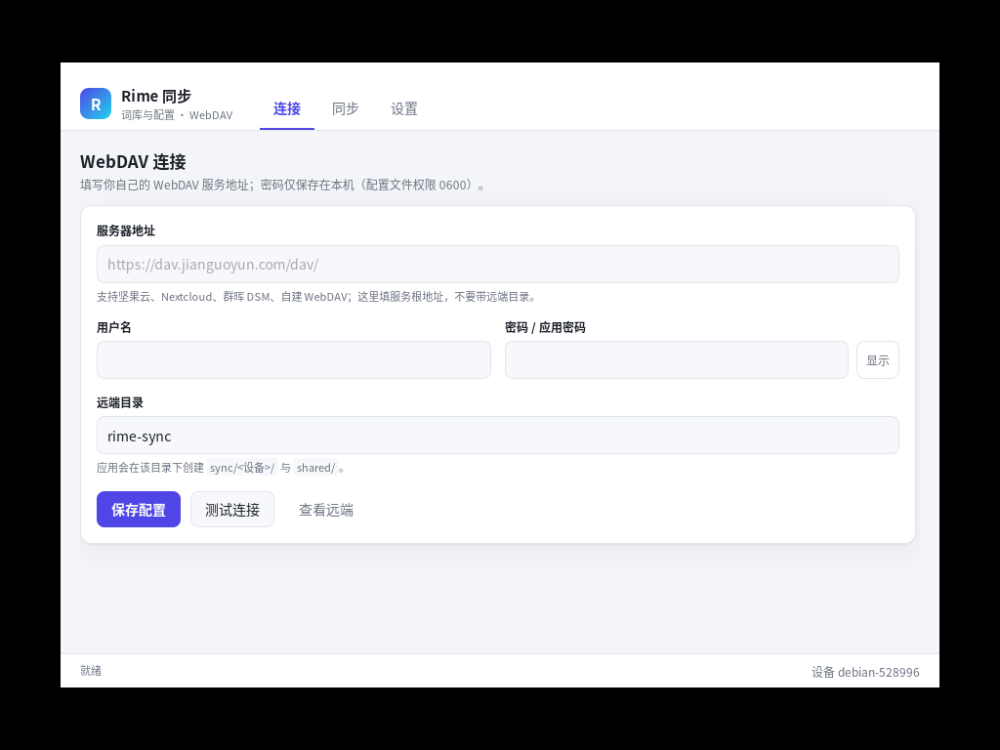
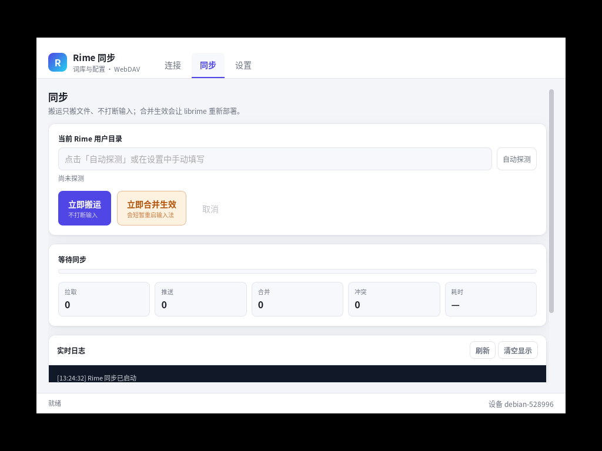
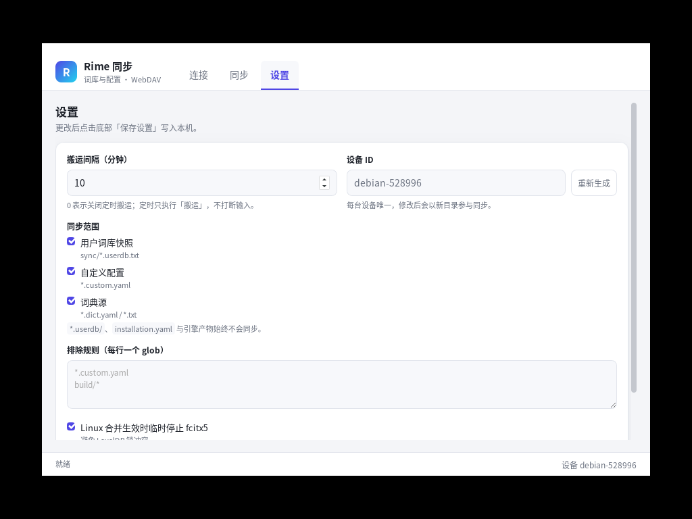
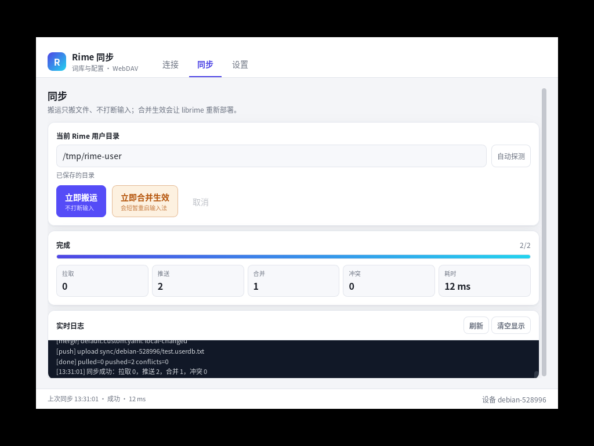

# rime-sync

把 Rime 的**用户词库快照、自定义配置、词典源**通过**你自己的 WebDAV** 在 Windows 与 Linux 之间双向同步。

- 不做账号、不做服务端、不做遥测；密码只留在本机。
- 后台只搬文件（transport），**不打断输入**；需要真正合并生效时才手动 apply。
- 硬红线：`*.userdb/`（LevelDB 目录本体）与引擎产物 `build/`、`*.bin` **永不同步**。

支持 Rime 发行版：Windows 小狼毫（Weasel）、Linux fcitx5-rime / ibus-rime。

---

## 截图

| 连接 | 同步 |
|---|---|
|  |  |

| 设置 | transport 完成 |
|---|---|
|  |  |

> 截图来自本机实测（Linux + 本地 rclone WebDAV），不是设计稿。

---

## 1. 同步什么，不同步什么

| 类别 | 匹配 | 处理 |
|---|---|---|
| 用户词库快照 | `sync/<设备>/*.userdb.txt` | 只搬文件，交给 Rime 自己合并 |
| 自定义配置 | `*.custom.yaml`、`user.yaml` | 三向合并；`patch:` 映射支持 key 级合并 |
| 词典源 | `*.dict.yaml`、词表 `*.txt` | 三向合并 |
| 引擎产物 | `build/`、`*.bin`、`*.prism.bin`、`*.table.bin` | **排除** |
| LevelDB | `*.userdb/`、`*.userdb` | **排除（硬红线）** |
| 设备私有 | `installation.yaml` | **排除** |

远端布局：

```text
<远端目录>/
├─ sync/<device_id>/owner.json          # 设备占用与心跳
├─ sync/<device_id>/<词典>.userdb.txt   # 词库快照（只走 sync/，不进 shared/）
└─ shared/files/...                     # 配置与词典源
   shared/manifest.json
```

---

## 2. 两种模式

| | **transport（传输）** | **apply（应用）** |
|---|---|---|
| 做什么 | pull → 三方合并 → push，只动文件 | 在 transport 之后触发 Rime 真正合并/部署 |
| 触发 | 定时（默认 10 分钟）/ 手动 / 文件变化监听 | **仅手动** |
| 是否打断输入 | 否 | 是（Linux 会临时停 fcitx5，Windows 会调 WeaselDeployer） |
| 适用 | 日常后台同步 | 换机、批量导入、确认新词生效 |

Linux 上 fcitx5 常驻会持有 userdb 的 LevelDB 锁，所以 apply 必须停 fcitx5 再跑
`rime_dict_manager --sync`；且该命令**失败也返回 0**，本应用按输出和文件时间判定成功。

---

## 3. 安装

### Windows 10/11

| 形态 | 文件 | 说明 |
|---|---|---|
| 安装版 | `rime-sync_<版本>_x64-setup.exe` | NSIS；内嵌 WebView2 **引导器**（`embedBootstrapper`），离线/内网机器也能装，运行时再补 WebView2 |
| 便携版 | `rime-sync_<版本>_x64-portable.zip` | 解压即用，不写注册表；卸载 = 删目录 |

- 安装后在开始菜单创建 **「Rime 同步」** 程序组；若检测到小狼毫（Weasel）程序组，也会在其中放一份快捷方式。
- 未做代码签名，SmartScreen 提示时选「更多信息 → 仍要运行」。

### Linux

```bash
# Debian / Ubuntu
sudo apt install ./rime-sync_<版本>_amd64.deb
sudo apt --fix-broken install        # 依赖缺失时

# 通用 AppImage
chmod +x rime-sync_<版本>_amd64.AppImage
./rime-sync_<版本>_amd64.AppImage
./rime-sync_<版本>_amd64.AppImage --appimage-extract-and-run   # 无 FUSE2 时
```

### fcitx5 配置页（可选）

`packaging/fcitx5-addon/` 提供一个 Qt 配置页与最小 fcitx5 addon，可直接读写
`~/.config/rime-sync/config.json`：

```bash
sudo apt install cmake g++ qt6-base-dev libfcitx5core-dev
cmake -S packaging/fcitx5-addon -B build/fcitx5-addon -DCMAKE_INSTALL_PREFIX=/usr
cmake --build build/fcitx5-addon
sudo cmake --install build/fcitx5-addon
rime-sync-config            # 或从应用菜单「Rime 同步 · 配置」打开
```

配置页字段：WebDAV 地址 / 用户名 / 密码 / 远端目录，另有 **「打开 Rime 同步」** 按钮。
> 本轮未在 CI 编译该 addon（构建机缺 fcitx5 开发头文件），详见该目录 README 的已知限制。

---

## 4. 首次使用

1. 启动后确认 Rime 用户目录（自动探测失败时手选）：
   - Windows：`%APPDATA%\Rime`
   - Linux + fcitx5：`~/.local/share/fcitx5/rime`
   - Linux + ibus：`~/.config/ibus/rime`
2. 设备名自动生成（`<主机名>-<6位随机>`）。**两台机器不要填同一个值**。
3. 填 WebDAV：地址 / 用户名 / 应用专用密码 / 远端目录（默认 `rime-sync`）。
4. 点「测试连接」：返回 207/200 即通。
5. 点一次 **transport**，远端出现 `shared/` 与 `sync/<设备>/` 即打通。

密码保存位置：优先系统钥匙串（service = `rime-sync`，account = WebDAV 用户名）；
无 Secret Service 的 headless 环境回落到 0600 文件，并在界面标明所用后端。

---

## 5. AList 配置（权限勾选表）

AList 的 WebDAV 地址是 `http://<主机>:5244/dav`，账号密码就是 AList 账号。

1. AList 后台 → **用户 → 编辑**，为该账号勾选：

   | 权限项 | 必须 | 用途 |
   |---|---|---|
   | Webdav Read | ✅ | PROPFIND 列目录、GET 下载快照 |
   | Webdav Manage | ✅ | MKCOL/PUT/DELETE，上传与清理 |
   | 存储「写入」 | ✅ | 上传 `shared/files/*`、`owner.json` |
   | 存储「删除」 | ✅ | 删除探测对象、清理过期快照 |
   | 存储「重命名/移动」 | 建议 | manifest 原子替换 |
   | 离线下载 / 其他 | ❌ | 与本工具无关 |

2. 「远端目录」要带**挂载路径前缀**，例如挂载点叫 `aliyun`，则填 `aliyun/rime-sync`。
3. 保存后点「测试连接」；若失败，用写权限探测（v0.2.0 的 `rime-sync-cli probe`，或下面的 curl）看具体 HTTP 状态：
   - `403` + AList：几乎都是没勾 Webdav Read / Webdav Manage，或存储本身只读。
   - `404`：地址少了 `/dav`，或远端目录前缀写错。

---

## 6. 命令行（headless）

```bash
rime-sync-cli --help
rime-sync-cli --json status
rime-sync-cli transport
rime-sync-cli apply
```

| 命令 | 作用 |
|---|---|
| `detect` | 探测 Rime 用户目录 |
| `test-conn` | 测试 WebDAV 连通性 |
| `status` | 配置、本地文件数、远端设备 |
| `transport` | 只搬文件（pull → merge → push） |
| `apply` | 合并 + 部署 + push |
| `backup` / `backups` / `rollback <id>` | 手动备份、列备份、回滚（v0.2.0） |
| `watch` | 前台监听本地变化并跑 transport（v0.2.0） |
| `probe` | WebDAV 写权限探测（v0.2.0） |

全局参数：`--config <path>`、`--rime-dir <path>`、`--dav-url/--dav-user/--dav-pass`、`--json`。
`--dav-pass` 只在内存中使用，不落盘。

---

## 7. 开发与构建

```bash
pnpm install
pnpm tauri dev                 # 开发
cargo test --workspace         # Rust 单测
pnpm exec tsc --noEmit         # 前端类型检查
bash .github/scripts/e2e-rclone.sh   # 本地 rclone E2E（需先 cargo build -p rime-sync-cli）
```

出包（会产出安装包，非必要不要跑）：

```bash
pnpm tauri build --bundles deb,appimage                  # Linux
pnpm tauri build --bundles nsis                          # Windows
pwsh -File packaging/portable-zip.ps1                    # Windows 便携 zip
```

系统依赖与体积预期见 [packaging/README.md](packaging/README.md)；平台机制细节见
[docs/platform-notes.md](docs/platform-notes.md)；用户手册见 [docs/USER-GUIDE.md](docs/USER-GUIDE.md)。

---

## 8. CI 与发布

| 工作流 | 触发 | 内容 |
|---|---|---|
| [`.github/workflows/ci.yml`](.github/workflows/ci.yml) | push（master/main）、PR、手动 | `cargo fmt --check`、`cargo clippy -D warnings`、`cargo test --workspace`、`tsc --noEmit`、**rclone E2E**（两轮幂等 + userdb 红线） |
| [`.github/workflows/release.yml`](.github/workflows/release.yml) | tag `v*`、手动指定 tag | Linux `deb` + `AppImage`；Windows `NSIS` + 便携 `zip`；汇总生成 `latest.json` 并上传 Release |

### 自动更新（需要你替换占位）

`src-tauri/tauri.conf.json` 里目前是占位值：

```json
"plugins": {
  "updater": {
    "endpoints": ["https://REPLACE-ME.example.com/rime-sync/{{target}}/{{arch}}/{{current_version}}"],
    "pubkey": "REPLACE_WITH_TAURI_SIGNING_PUBLIC_KEY"
  }
}
```

替换步骤：

1. 生成密钥：`pnpm tauri signer generate -w ~/.tauri/rime-sync.key`（会打印公钥）。
2. 公钥填进上面的 `pubkey`；私钥内容与口令分别存为仓库 secrets
   `TAURI_SIGNING_PRIVATE_KEY`、`TAURI_SIGNING_PRIVATE_KEY_PASSWORD`。
3. `endpoints` 改成你自己的静态地址。二选一：
   - 指向 Release 资产里的 `latest.json`：
     `https://github.com/<owner>/<repo>/releases/latest/download/latest.json`；
   - 或指向自建服务器，返回同样结构的 JSON（`version` / `notes` / `pub_date` / `platforms`）。
   模板变量 `{{target}}`、`{{arch}}`、`{{current_version}}` 由 Tauri 运行时替换；不写变量也可以。
4. `bundle.createUpdaterArtifacts` 已设为 `true`：**没有签名私钥时 release 构建会失败**，
   这是刻意的——不允许发布无法校验的更新包。

> 不打算用自动更新时：把 `createUpdaterArtifacts` 改回 `false`，并去掉 `plugins.updater`。

---

## 9. 数据与隐私

- 只上传白名单文件；LevelDB 目录与引擎产物永不出本机。
- 密码优先存系统钥匙串，兜底文件权限 0600；不写日志、不进远端。
- 远端只有你配置的目录；没有第三方中转。

---

## 10. 许可

MIT，见 [LICENSE](LICENSE)。版权所有 (c) 2026 li2966068。
